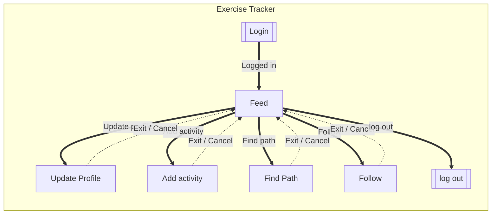
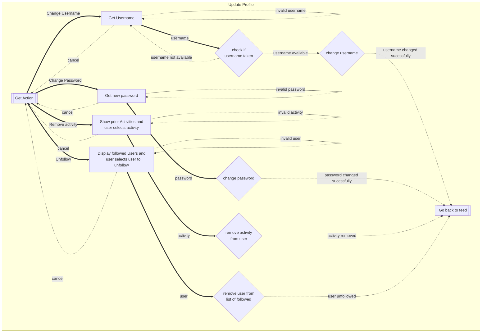
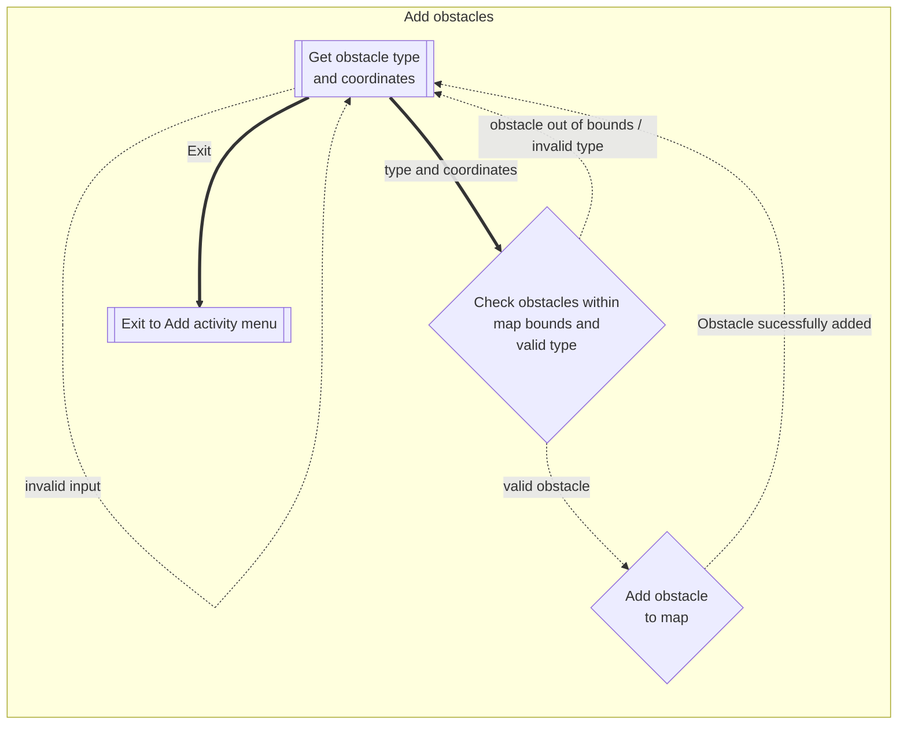
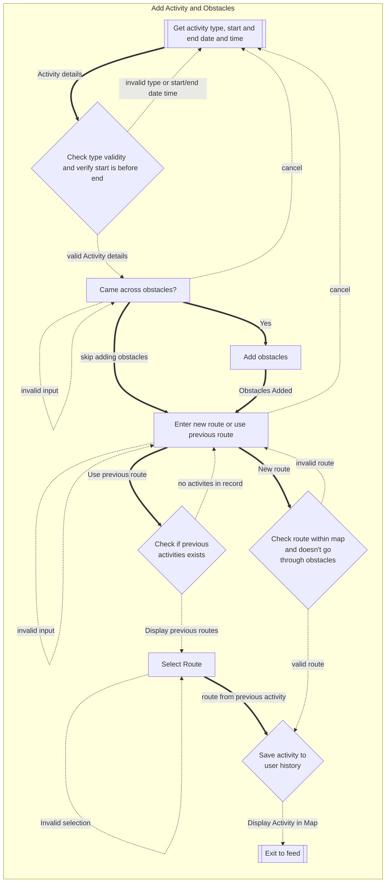
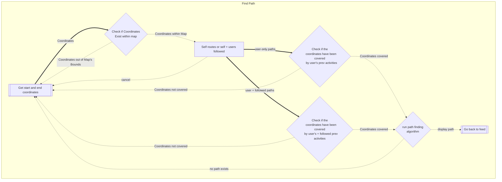
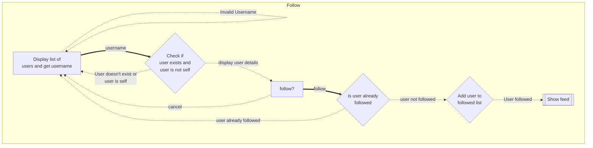
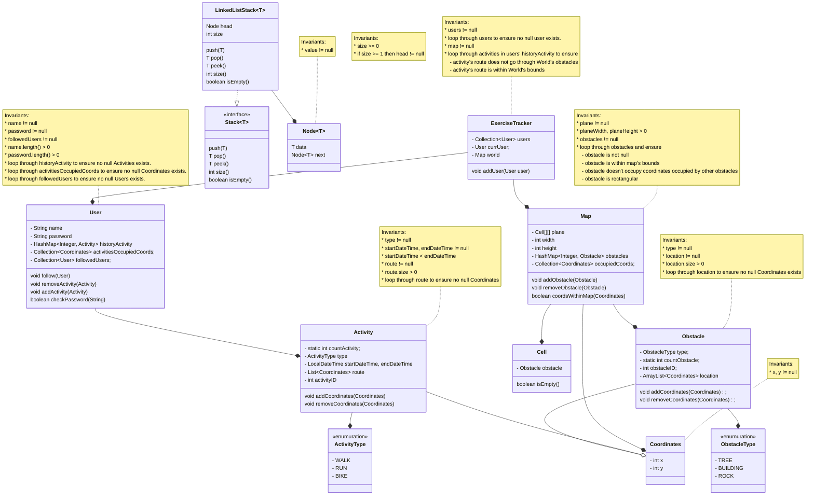

# Kudh (Exercise Tracker)
**Author: Yudil Pariyar **
---

### Instructions to run the application
The app has been built and tested to be run in IntelliJ. Open the project there, open the "ca.umantioba.ca.pariyary" folder,
then the "TrackerMain.java" file. Finally, click "Current File" in the top menu bar and run!

### Resources
Some inspiration taken from Strava [https://www.strava.com/]

Learned how to check if given points form a rectangle in the matrix from [https://stackoverflow.com/questions/41516164/how-to-know-if-a-list-of-coordinates-forms-a-rectangle]
 for obstacle invariant

Learned about Manhattan distance to ensure that Activity routes are continuous from https://www.datacamp.com/tutorial/manhattan-distance

### Changes
- Addition of logic, ui and exception packages.
- Moved all app logic function from ExcessiveTracker class to the logic layer
- REPL is commented out to allow the program to compile

### Flows of Interactions

### Overview

<small>Kudh is an exercise tracker. Users are able to track their activities within a map (2D Matrix).
Users are able to choose between 3 activities: Run, Walk and Bike.
It stores their activities with information including start date and time, end date and time, and route taken.
Users are also able to access their past activities. Users have access to a feed where they can see activities of people
they follow. Users are able to follow/unfollow people within and make changes to their accounts (change password/username
, delete activities etc)

## Domain model

### Diagram

Below is the Domain model diagram.
