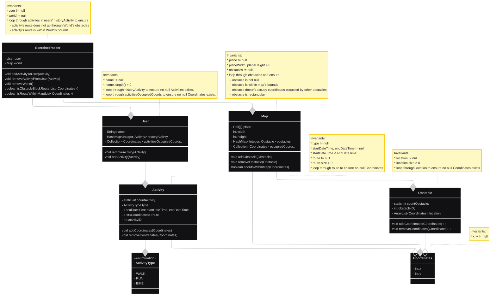

# Kudh (Exercise Tracker)
**Author: Yudil Pariyar (pariyary@myumanitoba.ca) **
**Term: Winter 2026**
---

### Resources
Some inspiration taken from Strava [https://www.strava.com/]

Learned how to check if given points form a rectangle in the matrix from [https://stackoverflow.com/questions/41516164/how-to-know-if-a-list-of-coordinates-forms-a-rectangle]
 for obstacle invariant

### Overview
<small>Kudh is an exercise tracker. Users are able to track their activities within a map (2D Matrix).
You are prompted to create a map, and you route your activity through the map.
Users are able to choose between 3 activities: Run, Walk and Bike.
It stores their activities with information including start date and time, end date and time, and route taken.
Users are also able to access their past activities.<small>

### Changes
- Location Validation Invariants 
    - The major design change that I implemented is that all location validation is handled in the Map class to follow the
      Single Responsibility Principle. Activities, obstacles, and coordinates can be created independently,
      the Map is responsible for ensuring they are within valid bounds.
      The ExerciseTracker acts as a middleman, validating a user’s activity routes against the map.

### Notes for the grader:

Obstacle Class 
- Obstacles can occupy multiple grids/entries within the matrix since obstacles in real life (trees, buildings etc)
  are much bigger than people, hence obstacles have a collection of Coordinates.

Map Class - Coordinates Validation 
- Top left corner of the matrix will be Coordinates(0,0). Hence, the xCoordinate will be integers >= 0 and yCoordinate will be integers >= 0, y will extend only downwards so only the use of positive numbers are used.

Each grid in the matrix represents an area of 1 km²

### REPL

### Building and Running the REPL

The project has been built and tested to be run in IntelliJ. Open the project
there, open the "ca.umantioba.ca.pariyary" folder, then the "REPL" file.
Finally, click "Current File" in the top menu bar!

- If map doesn't exist, user doesn't get access to anything other than ADD MAP, entering HELP
  when map doesn't exist only lists one command, ADD MAP, rest of the commands are unveiled only
  when user creates a map.
- HELP - Prints out list of commands available
- ADD MAP - Prompts you to enter Map Height and Width, Creates Map accordingly. Unveils rest of the available commands
- ADD OBSTACLE - Creates an obstacle and adds it to Map, prompts to enter everything required for an Obstacle
- ADD ACTIVITY - Creates an obstacle and adds it to Map, prompts to enter everything required for an Activity
- SHOW MAP - Prints out a visual representation of the map as a grid of ASCII symbols
- SHOW OBSTACLES - Prints out the list of obstacles and their properties
- SHOW ACTIVITIES - Prints out the list of activities and their properties
- SHOW ACTIVITY - Lists all activities available, prompts you to enter an activity ID, prints selected activity on Map
- REMOVE ACTIVITY - Prompts you to select an activity and removes it
- REMOVE OBSTACLE - Prompts you to select an obstacle and removes it
- REMOVE MAP - Deletes current map

A lot of code that is commented out contains user input validation. These were commented out as
invariants need to be triggered.

## Domain model

### Diagram

Below is the Domain model diagram.
